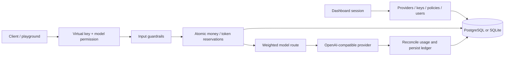

# Architecture

- `server/`: Fastify administration, proxy, credentials, asynchronous application storage, database migrations and CLI.
- `client/`: React dashboard and playground; Vite produces `dist/`.
- `build/`: compiled Node server and CLI, generated by TypeScript.
- `tests/`: local mock-provider integration checks.
- `packaging/python/`: thin Python launcher containing the same npm runtime archive.
- `scripts/`: release assembly, artifact checks and smoke tests.
- `docs/`: installation, operation and release guidance.

The npm archive, wheel and container all execute the same Node server. The server needs Node's built-in SQLite API; the container supplies Node 24. Dashboard files are served from the installed package, independently of the launch directory.

A single process owns each data directory. PostgreSQL additionally enforces one process per database with a session advisory lock. Async application storage selects PostgreSQL explicitly or adapts SQLite while preserving transaction isolation across await boundaries. Short PostgreSQL write transactions serialize admission with quota and permission updates; provider calls hold no database connection. Completed usage survives request-log cleanup. Model calls are retried only after explicit HTTP 429 responses; ambiguous failures retain estimated charges.

The current source uses schema 5 for member permissions, shared allowances and approvals; published application version 0.2.2 uses schema 3. All changes use explicit migrations. The current workspace model is preparatory isolation, not multi-tenant SaaS. AWS catalog discovery and public pricing use AWS APIs, but native Bedrock Converse invocation, SSO, billing and multiple gateway workers are future work.

The production target is thousands of users and concurrent requests. The current implementation has not been qualified for that workload. The [production architecture and qualification plan](PRODUCTION_PLAN.md) prioritizes PostgreSQL, cross-instance accounting and load/failure testing, and separates proposed capacity targets from measured results.

The PostgreSQL runtime schema is `gate_app`, with checksummed migration history and a fingerprint of the persistent encryption key. IDs remain text for lossless import of existing `default` workspace IDs. The earlier `gate_core` bigint quota prototype remains separate and is not used by HTTP handlers. [PostgreSQL operations](POSTGRESQL.md) covers deployment, offline import, backup and failure behavior. This first integration retains serialized writes and single-instance recovery; it does not claim the future architecture's horizontal scaling guarantees.
