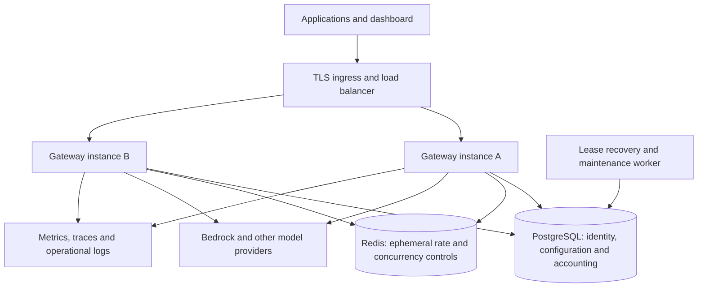

# Production architecture and qualification plan

Status: implementation started; production path and capacity qualification remain incomplete. Updated 2026-10-14. The [PostgreSQL application integration](POSTGRESQL.md) now adds async handlers, persistent identity/configuration/accounting, single-process ownership, controlled import and Compose setup. The original local SQLite installation is not automatically migrated. Horizontal scaling and capacity qualification remain outstanding.

GATE's intended deployment routes requests from applications serving thousands of end users. A GATE member creates an application key; the application's backend uses that key on behalf of its users. Application users do not require GATE dashboard accounts. The current SQLite implementation is an internal beta. Functional tests, container packaging and working permissions do not establish production capacity. PostgreSQL and multi-instance correctness take priority over further catalog or dashboard features.

## Identity and application traffic

Separate workspace owners/members (administration), application keys (gateway authentication), and application end users (authenticated by the application). Keys stay on application backends, not in browser/mobile bundles. Budget ownership, model permissions and required guardrails belong to the GATE member/application key; thousands of end users can share that spending authority. Admission must serialize conflicting budget updates safely without holding locks throughout inference.

Optional per-end-user usage or abuse limits require a future explicit identity contract: a pseudonymous identifier supplied by the authenticated app backend, scoped to its workspace/application and bounded against cardinality abuse. It must not grant model access, override budgets or be trusted merely because a browser supplied it. Existing member usage represents the GATE member, not automatically each end user of their application. Do not claim end-user analytics or quotas before implementing this distinction.

## Capacity contract

The user confirmed thousands of application end users, not thousands of GATE accounts. Exact traffic rate and concurrency remain unmeasured. Use **1,000 simultaneous streaming requests across at least two gateway instances** as a provisional stress target, not a user-confirmed requirement or supported-capacity claim. Registered users, requests per second and active streams are separate measurements. A workload averaging 20 seconds per stream needs approximately 50 admitted requests/second to sustain 1,000 streams; this is a workload calculation, not a benchmark result.

Provisional qualification workload:

- Primary case: 1,000 simulated application users through one application key, one member allowance and one model route. Also test 10 application keys sharing one member allowance, and many independent applications/members. All three must pass; spreading traffic across independent keys must not hide contention on a popular application's key or budget.
- Ramp through 100, 500 and 1,000 active streams. Sustain the target for 60 minutes and run an 8-hour soak. Also run an open arrival-rate test so queuing cannot hide overload.
- Deterministic simulated upstream: 20-second streams, 1,000 reported input tokens and 500 output tokens; repeat with larger prompts, tools, slow clients and mixed streaming/non-streaming requests. Publish the actual payload sizes and cadence.
- Tentative gateway-added admission/first-byte latency target: p95 <= 100 ms and p99 <= 250 ms under the qualified workload, measured against the same upstream directly. Separate time waiting for the provider from gateway overhead.
- Unexpected gateway failure rate below 0.1% in the healthy-upstream case, with zero lost or duplicate settlements, unauthorized admissions or reservation-limit violations. Report deliberate policy/overload rejections separately; do not count rejected load as served capacity.
- Record hardware, instance count, database configuration, connection limits, TLS/ingress configuration, CPU, RSS, event-loop delay, database waits, throughput and stream completion rates. Check that memory and outstanding reservations return toward baseline after load drains.

These targets are proposed gates and may require measured adjustment. Provider quotas, model latency and upstream GPU capacity independently constrain end-to-end throughput. Gateway tests use simulated providers; paid provider load tests require a defined spend limit.

## Findings in the current implementation

| Evidence | Consequence | Required change |
| --- | --- | --- |
| Async application storage now supports PostgreSQL; SQLite remains a compatibility backend | PostgreSQL short writes still serialize; history sums remain in admission | Per-account/period repositories and finer-grained transaction locks |
| `server/store.ts` and `server/directory-lock.ts`: directory ownership and recovery of all outstanding reservations on startup | A second live instance is unsupported; global recovery could settle another instance's active work | Per-request ownership leases, fencing and idempotent recovery |
| `server/gateway.ts`: hard-coded eight in-flight reservations per key | One application key cannot serve high concurrent application traffic | Owner-configured application/key concurrency, constrained by workspace/provider capacity and shared across replicas |
| `server/upstream.ts`: 16 connections per origin | Long streams can occupy the pool and make later requests wait | Configurable bounded pools, provider concurrency admission and explicit overload rejection |
| `server/app.ts` and `server/gateway.ts`: process-local sign-in/tokenizer counters | Limits multiply when more instances start | Shared abuse/rate controls with specified dependency-failure behavior |
| `server/store.ts`: synchronous scrypt during login | Login bursts compete with inference for the event loop | Async password hashing with bounded concurrency and shared login throttling |
| Current quota and settlement logic is tested in one process | Does not establish cross-instance isolation or failure safety | Concurrent PostgreSQL tests and fault injection with two or more real gateway processes |
| Current structured logs and readiness checks | No measured saturation, latency or distributed recovery view | Metrics, traces, dashboards, alerts and restore drills |

## Target deployment

Keep a modular Node/Fastify application initially; multiple services and Kubernetes are not prerequisites. PostgreSQL is the production source of truth. Redis supports atomic ephemeral limits and bounded coordination; it is not the authoritative money/token ledger. SQLite remains explicitly a local/demo mode only if maintaining parity does not compromise the production implementation. No process needs sticky dashboard sessions once session storage is shared.

Production configuration must include database TLS where appropriate, least-privilege runtime credentials, a separate migration identity, bounded connection pools and timeouts, and a shared externally supplied encryption secret with a versioned rotation procedure. Never generate different encryption keys independently on each replica. Protect database backups and encryption-key recovery together. Role checks and workspace/member ownership checks remain backend responsibilities.

## Accounting invariants

1. Admission atomically checks current key/member access and relevant quota buckets, then records one durable reservation. Use a fixed row-lock order across all quota-mutating operations. Do not hold a database transaction or pooled connection while waiting for an LLM stream.
2. Store quota buckets by owner and period to avoid scanning historical usage on every request. Store money in integer microdollars, tokens as integers, and prices as exact decimals; explicitly handle PostgreSQL bigint/decimal values without unsafe JavaScript number conversions.
3. Snapshot reservation owner, quota period, deployment pricing and policy/configuration version. Retain attribution through key rotation, reassignment and revocation. Revalidate admission if relevant access/policy settings change during asynchronous work.
4. Settlement is an idempotent state transition keyed by a unique internal request ID. The usage ledger, quota changes and reservation transition commit together. Repeated completion, recovery or event delivery cannot charge twice.
5. Each in-flight reservation has lease ownership and a fencing/version token. A new gateway must not recover another live gateway's work. Lease expiry and settlement race through the same conditional transition; stale owners cannot overwrite recovery results.
6. Failed or ambiguous provider calls may already be billable. Preserve conservative reservations/estimated charges and do not automatically replay generation after an uncertain outcome. This provides exactly-once local settlement, not exactly-once external model execution.
7. Estimates cannot guarantee actual provider token counts or invoices. Record and surface excess actual usage rather than hiding it to make the cap appear satisfied. Test reservation enforcement separately from provider-report reconciliation.
8. Database failure blocks new admissions. Active streams retain durable reservations; settlement retries/recovery must be bounded and idempotent. Redis failure must not silently disable configured limits: specify fail-closed admission or a separately tested shared fallback. Document the impact on already active streams.
9. Revocation/suspension prevents new admitted work across all instances. Any authorization cache must have a tested invalidation protocol and explicit consistency bound; begin with authoritative reads.

## Delivery sequence and release gates

### 1. PostgreSQL foundation — initially one gateway process

- Introduce asynchronous repositories for identity/access, configuration, quota admission, settlement and reporting. Keep transactions on a single checked-out connection; do not mechanically substitute PostgreSQL behind synchronous SQLite calls.
- Add explicit schema migrations, constraints/indexes, readiness, pool/statement/lock timeouts and database error sanitization.
- Convert authentication and all request handlers, maintenance and reporting paths. Preserve existing API behavior and permission boundaries.
- Docker Compose must start GATE and PostgreSQL with persisted state, health checks and documented setup. Compose on one host is not high availability.
- Add a controlled SQLite export/import into an empty PostgreSQL database. Preserve IDs, users/password hashes, virtual-key hashes, encrypted provider credentials and their encryption key, permissions, quotas and usage. Invalidate sessions at cutover. Drain/resolve in-flight requests, back up, validate row counts and financial/token totals, then switch. Never overwrite the source database.
- Gate: integration, authorization, migration and restore tests pass against real PostgreSQL. Publish as PostgreSQL support with single-instance limits until stage 2 passes. A SQLite rollback after accepting new PostgreSQL traffic requires reconciliation; the old snapshot alone is not a lossless rollback.

### 2. Multiple gateway instances and controlled overload

- Implement atomic shared quota buckets, idempotent settlement, ownership leases and recoverer election/claiming. Move ephemeral rate/concurrency controls to Redis with explicit outage behavior.
- Bound global, workspace/user/key and provider concurrency; bound or reject queued work, honor cancellation/backpressure, configure upstream pools and apply circuit breakers without duplicate generation retries.
- Add asynchronous password hashing and bounded authentication work. Enforce consistent authorization and secret availability across replicas.
- Gate: at least two real processes prove shared-budget races, simultaneous approval/rotation/revocation, duplicate settlement, calendar rollover, crash during inference/settlement, stale lease owners, PostgreSQL/Redis outages and rolling drain/restart. No double-spend or duplicate ledger entries under these tests.

### 3. Operational and capacity qualification

- Instrument admission latency, active streams, rejection reasons, pool/queue depth, event-loop delay, provider time-to-first-token, completion errors, settlement failures, lease age and estimated charges. Avoid secrets/prompt capture and high-cardinality user/key labels in metrics.
- Move cleanup/aggregation to bounded maintenance jobs. Exercise retention, storage growth, backup scheduling, restore and recovery-point/recovery-time objectives. Deployment-specific availability objectives remain to be agreed and measured.
- Run the capacity contract and fault tests on documented representative infrastructure. Publish reproducible results, limits and remaining risks with the release.
- Review tenant/member isolation, secret rotation, TLS ingress, dependency vulnerabilities and operational access. Multi-tenant SaaS still requires its own isolation and provisioning review.
- Gate: only claim production capacity for the measured workload and topology. The existing 88 functional tests are regression evidence, not a load certification.

Native Bedrock text invocation is included in version 0.3.0; see [current Bedrock behavior](BEDROCK.md). This does not qualify the gateway for the production capacity targets in this plan. Provider expansion must preserve these release gates.
